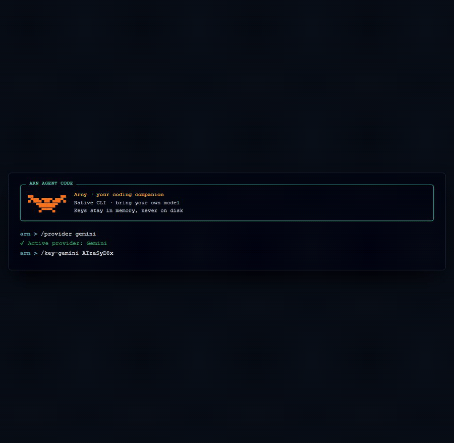

# ARN Code

**ARN Code is a lightweight native C++23 coding assistant for projects on your
machine.** Its native providers stream answers from Gemini, DeepSeek, OpenRouter,
or a local OmniRoute server, with project file tools that require approval for
changes. The CLI also supports Kiro through ACP as an external agent backend.
Native provider mode has no Node.js or Python runtime dependency; external
backends have their own installation and authentication requirements.

Use it when you want a small terminal-first assistant—or the included Windows
IDE—while keeping provider calls, model selection, and local file access under
your control.

ARN is the broader ecosystem. ARN Code is built on
[ARN Core](https://github.com/ARN-Forge/arn-core), the reusable native C++23 AI
agent framework shared by ARN applications.



## What ARN Code does today

- Runs as a native `arn` executable on Windows, Linux, and macOS release
  targets. Windows also has a portable Tauri 2 + React IDE.
- Connects to **Google Gemini**, **DeepSeek**, **OpenRouter**, and **OmniRoute**
  using your own API key, or to an installed/authenticated **Kiro CLI via ACP**.
- Verifies native provider access through model discovery and lets you choose
  a model with `/models` and `/model`. A listed model is not a guarantee of
  generation access for the current account/session.
- Streams responses, retries temporary API failures, and cancels an active
  request with `Esc` or `Ctrl+C`.
- Keeps native provider keys and conversation history in memory only. Kiro
  manages its own credentials, sessions, and tools outside ARN Code.
- Lets native models list and read project files, or request creates, edits, and
  deletions that require explicit approval.
- Provides Explorer, Planner, Coder, and Reviewer workflows through `/agent`,
  with the same provider, sandbox, and confirmation boundaries as native chat.

The provider foundation from **Phase 1** of
[AGENTS_ROADMAP.md](AGENTS_ROADMAP.md) remains in place: `ApiClient` is a
provider-neutral facade over ARN Core. The CLI's ACP integration is a separate
transport for external agents, not an additional native model provider.

## Install

### Windows

Run this in **PowerShell**, not Command Prompt (`cmd.exe`):

```powershell
irm https://raw.githubusercontent.com/ARN-Forge/ARN-Code/main/scripts/install.ps1 | iex
arn
```

The installer uses `%LOCALAPPDATA%\Arn\bin`, adds it to your user `PATH`, and
verifies the installed executable. Open a new terminal if `arn` is not yet
visible in another terminal window.

ARN Code on Windows needs the **Microsoft Visual C++ Redistributable (x64)**,
which it does not ship. If it is missing, the installer stops before changing
anything and shows Microsoft's link, <https://aka.ms/vc14/vc_redist.x64.exe>:
install it (this needs administrator rights) and run the installer again.

This installs the latest **stable** release. There is no Windows build of the
v0.9.0 prerelease (see [Versions, prereleases and downgrades](#versions-prereleases-and-downgrades)).

To install a specific release instead, set `ARN_VERSION` first (`X.Y.Z` and
`vX.Y.Z` both select tag `vX.Y.Z`); the release must have a Windows package and
a `SHA256SUMS` (see [Release checksums](#release-checksums)):

```powershell
$env:ARN_VERSION = "X.Y.Z"
irm https://raw.githubusercontent.com/ARN-Forge/ARN-Code/main/scripts/install.ps1 | iex
Remove-Item Env:\ARN_VERSION
```

A downloaded copy of the script also takes `-Version X.Y.Z`.

### Linux and macOS

```bash
curl -fsSL https://raw.githubusercontent.com/ARN-Forge/ARN-Code/main/scripts/install.sh | sh
arn
```

The script installs to `~/.local/bin`, adds that directory to your shell
profile when needed, and verifies the executable. Unix archives use system
OpenSSL libraries: on Linux install the OpenSSL runtime supplied by your
distribution; on macOS run `brew install openssl@3` first.

Minimum systems for the release archives: macOS 15 (Apple Silicon or Intel)
with Homebrew's `openssl@3`; Linux x64 with glibc 2.39 or later, the
libstdc++ of GCC 13 or later and OpenSSL 3 (for example Ubuntu 24.04 or
Debian 13; Ubuntu 22.04 and Debian 12 are too old).

This installs the latest **stable** release.

### Versions, prereleases and downgrades

Without `ARN_VERSION`, both install scripts install the latest stable release
and never pick a prerelease.

**v0.9.0 is a prerelease for Linux x64 and macOS (Apple Silicon and Intel)
only.** It is not the latest stable release, and the commands above do not
install it. To try it, name it explicitly:

```bash
curl -fsSL https://raw.githubusercontent.com/ARN-Forge/ARN-Code/main/scripts/install.sh | ARN_VERSION=0.9.0 sh
```

Put `ARN_VERSION=0.9.0` after the `|`, directly before `sh`: written before
`curl` it does not reach the installer, which then installs the latest stable
release instead.

The v0.9.0 prerelease has no Windows CLI or Windows IDE package. Those packages
include Microsoft Visual C++ runtime files, and their redistribution has not
been cleared yet; no date is set. On Windows, `ARN_VERSION=0.9.0` stops with
"no build for Windows x64" and changes nothing.

**Downgrades.** The installers never replace an installed version with an older
one unless you allow it with `ARN_ALLOW_DOWNGRADE=1` (no other value is
accepted). Naming the older version with `ARN_VERSION` is not enough. For
example, to go back from the v0.9.0 prerelease to the latest stable release:

```bash
curl -fsSL https://raw.githubusercontent.com/ARN-Forge/ARN-Code/main/scripts/install.sh | ARN_ALLOW_DOWNGRADE=1 sh
```

```powershell
$env:ARN_ALLOW_DOWNGRADE = "1"
irm https://raw.githubusercontent.com/ARN-Forge/ARN-Code/main/scripts/install.ps1 | iex
Remove-Item Env:\ARN_ALLOW_DOWNGRADE
```

The installer prints a warning when it downgrades. Without the variable it
stops without changing anything, names both versions and shows the command to
run.

**When nothing can be installed.** If the latest stable release has no package
for your platform or no `SHA256SUMS`, the installer does not fall back to an
older release by itself: it installs nothing and prints the command for the
newest release it could install (and for a newer prerelease, if there is one),
for you to run if you want it.

### Updating

Run the install command again. The new release is downloaded, checked against
`SHA256SUMS`, extracted and test-run in a temporary location first; a failed
download, checksum, extraction or version check leaves the installed version
exactly as it was.

- **Windows:** the new files are staged in a hidden `.arn-staging-*` directory
  next to the install directory (on the same volume). ARN's current files are
  then moved aside to `.arn-backup-*`, the new files moved in, and the
  installed `arn.exe --version` and `PATH` lookup checked. If any of that
  fails, the new files are taken out and the previous ones moved back, and the
  user `PATH` is put back exactly as it was. An open ARN does not block an
  update (Windows allows renaming a running executable); its old files stay
  in `.arn-backup-*` until a later installation removes them. A file another
  program locks is retried briefly and otherwise reported, and the previous
  version is restored.
- **Linux and macOS:** `arn` is staged in a hidden `.arn-install.*` directory
  inside the install directory and replaced with a single rename, so `arn` is
  always either the old or the new executable. Copies of the previous
  executable and manifest are kept until the new one passes its checks, and
  are put back if they fail or the installer is stopped by a signal (it then
  exits with a non-zero status). Your shell profile is edited by writing a new
  copy next to it and renaming it into place, keeping its permissions and any
  symbolic link to it; if the profile cannot be updated, or changed while it
  was being updated, `arn` is still installed and the installer prints the
  `PATH` line to add yourself.

**Interrupted updates.** Updating is not one atomic operation (Windows moves
several files one by one), so each run first writes a transaction record into
the install directory (`.arn-transaction.json` on Windows,
`.arn-install-transaction` on Linux and macOS) and updates it as it goes. If a
run is killed, crashes or loses power part-way, the next run of the installer
(install or uninstall) finds the record and, before doing anything else, puts
the previous installation back; a fresh installation is removed again. This
recovery can itself be interrupted and repeated. A backup is only deleted once
its installation has committed. Two installers running at the same time into
the same directory are not supported.

**When recovery stops.** Recovery does not force its way through. If it finds
something it cannot account for, it stops and names it, for example:

- a missing work directory (`.arn-staging-*` on Windows, `.arn-install.*` on
  Linux and macOS) that it needs to tell its own files from others;
- a transaction record that is damaged or belongs to another directory;
- on Windows, a file of yours where it would put a previous file back, a file
  with a package name where the installation had not got to yet, or a manifest
  that it cannot show it wrote itself.

On Windows every condition is checked first, so a stopped recovery has changed
nothing. On Linux and macOS a missing work directory or an unusable record also
stops it before any change; if one restore step fails, the steps that succeeded
are kept, and they are safe to repeat. In every case the transaction record and
the backup (`.arn-backup-*` next to the install directory on Windows, the
`.arn-install.*` work directory on Linux and macOS) are kept: they may hold the
only copy of your previous version. Do what the message says (typically, move
a file of yours that it names out of the install directory), then run the
installer again. For a damaged record the message explains how to put the
previous files back by hand. Do not delete `.arn-*` files or directories, the
record or the manifest to get past the message.

On Windows, the user `PATH` keeps its registry type (`REG_EXPAND_SZ` stays
`REG_EXPAND_SZ`) and `%VARIABLE%` references in other entries stay unexpanded;
the installer only adds or removes its own entry and never reorders others.

**Installation manifest.** Every successful installation writes a manifest
listing the files it installed (`install-manifest.json` on Windows,
`.arn-install-manifest` on Linux and macOS), together with the version, the
build commit, the install directory and whether the installer added the
directory to `PATH`. Only files a manifest lists are ever replaced or removed.
Other files you keep in the install directory are never touched. A manifest
that is malformed, lists anything but plain file names in that directory,
belongs to a different directory or is a link makes the installer stop without
changing anything.

**Older installations.** The installer never guesses which existing files are
ARN's; files that no manifest records are only replaced when you say so.

- **Windows, installed with the scripts of v0.7.0 or later:** those scripts
  wrote `install-manifest.json` as a plain list of file names. That older
  format is still read, so these installations update and uninstall normally.
- **Windows, installed with the scripts of v0.5 or v0.6:** these wrote no
  manifest. An update stops and names the files it would replace; uninstall
  also refuses. If they are ARN Code's, take them over once:

  ```powershell
  $env:ARN_ADOPT_EXISTING = "1"
  irm https://raw.githubusercontent.com/ARN-Forge/ARN-Code/main/scripts/install.ps1 | iex
  Remove-Item Env:\ARN_ADOPT_EXISTING
  ```

  (or `-AdoptExisting` with a downloaded copy). Only files with the names of
  the package's files are replaced and recorded; anything else in the
  directory stays as it is. After that, update and uninstall work normally.
- **Linux and macOS:** installers before this one did not record their files,
  so an existing `arn` without a manifest is not replaced or removed. If it is
  ARN Code, take it over once with:

  ```bash
  curl -fsSL https://raw.githubusercontent.com/ARN-Forge/ARN-Code/main/scripts/install.sh | ARN_ADOPT_EXISTING=1 sh
  ```

### Uninstall

```powershell
# Windows PowerShell
$env:ARN_UNINSTALL = "1"
irm https://raw.githubusercontent.com/ARN-Forge/ARN-Code/main/scripts/install.ps1 | iex
Remove-Item Env:\ARN_UNINSTALL
```

```bash
# Linux and macOS
curl -fsSL https://raw.githubusercontent.com/ARN-Forge/ARN-Code/main/scripts/install.sh | ARN_UNINSTALL=1 sh
```

A downloaded copy of `install.ps1` also takes `-Uninstall`. Set
`ARN_INSTALL_DIR` (or `-InstallDir`) to the same value as when installing if
you used a different directory.

Uninstall removes only the files the manifest lists and the manifest itself.
Everything else in the directory stays. It removes the install directory only
if it is then empty (on Linux and macOS, only if the installer created it; the
shared `~/.local/bin` normally stays). It takes out only the `PATH` entry the
installer added: the user `PATH` entry equal to the install directory on
Windows, or the two lines starting with `# Added by ARN Code installer:` in
your shell profile, provided you have not changed them. Running it again when
nothing is installed does nothing.

It checks every listed file before removing any, and refuses without changing
anything when there is no manifest but `arn` is present, when the manifest is
invalid, or when a listed file has been replaced by a link or directory. If a
file cannot be removed (on Windows, usually because ARN is still running),
uninstall reports it as incomplete, keeps it in the manifest and leaves `PATH`
unchanged. Close ARN and run it again. The `PATH` entry is removed only after
all files, and the manifest last, so an uninstall that is interrupted can
simply be run again.

To clean up by hand, first make sure no installation was interrupted: if the
install directory has a transaction record (`.arn-transaction.json` on Windows,
`.arn-install-transaction` on Linux and macOS), run the installer once and
follow its message instead (see **When recovery stops**). Otherwise delete only
the files the manifest lists, then the manifest (`install-manifest.json` on
Windows, `.arn-install-manifest` on Linux and macOS), and remove the install
directory from your user `PATH` (Windows) or the two
`# Added by ARN Code installer:` lines from your shell profile.

### Release checksums

Releases from v0.9.0 on publish `SHA256SUMS`, a list of the SHA-256 of each
release file. Earlier releases may not have one. Both install scripts download
it from the same release as the archive and check the archive against it
before extracting or running anything. If `SHA256SUMS` is missing, malformed,
lacks or repeats the archive's entry, or the hash differs, nothing is
installed, so a release without `SHA256SUMS` cannot be installed with these
scripts; download it from its release page instead.

To check a manual download, put `SHA256SUMS` from the same release page next
to it and run:

```powershell
# Windows PowerShell: the two values must match.
(Get-FileHash .\arn-windows-x64.zip -Algorithm SHA256).Hash.ToLower()
Select-String -Path .\SHA256SUMS -Pattern ' arn-windows-x64\.zip$'
```

```bash
# Linux: prints "arn-linux-x64.tar.gz: OK" when it matches.
grep ' arn-linux-x64.tar.gz$' SHA256SUMS | sha256sum --check
# macOS (use arn-macos-x64.tar.gz on Intel):
grep ' arn-macos-arm64.tar.gz$' SHA256SUMS | shasum -a 256 --check
```

A checksum detects a damaged or mixed-up download. It is not a signature:
`SHA256SUMS` is unsigned and is published beside the archives, so someone who
could replace a release archive could replace `SHA256SUMS` too. It does not
prove who published the release.

### Manual download

Download an archive from the [latest release page](https://github.com/ARN-Forge/ARN-Code/releases/latest)
(the latest stable release), extract it, and keep its files together so the
executable can find its bundled runtime libraries. Prereleases are listed on
the [releases page](https://github.com/ARN-Forge/ARN-Code/releases) and are
marked as such; the v0.9.0 prerelease contains only the Linux and macOS
archives.

A release contains some or all of these archives:

- **Windows x64 CLI:** `arn-windows-x64.zip`
- **Windows x64 IDE:** `arn-ide-windows-x64.zip` — extract it and start
  `arn-ide.exe`. It requires the [Microsoft Edge WebView2 Runtime](https://developer.microsoft.com/microsoft-edge/webview2/).
- **Windows x64 IDE installer:** `arn-ide-windows-x64-setup.exe`
- **Linux x64 CLI:** `arn-linux-x64.tar.gz`
- **macOS Apple Silicon CLI:** `arn-macos-arm64.tar.gz`
- **macOS Intel CLI:** `arn-macos-x64.tar.gz`

The Windows packages that the current release workflow builds are not part of
the v0.9.0 prerelease (see above). As built, they need the **Microsoft Visual
C++ Redistributable (x64)** on Windows 10 or 11 x64. ARN Code does not ship
the Visual C++ runtime: install it once from Microsoft,
<https://aka.ms/vc14/vc_redist.x64.exe> (installing it needs administrator
rights; Windows Update keeps it up to date). Many computers already have it.
The Windows CLI archive carries `arn.exe` and the OpenSSL DLLs it needs.
`install.ps1` and the IDE installer check for the runtime before they change
anything; when it is missing they stop with that link, and they never download
or install it themselves. ARN itself needs no administrator rights.

From v0.9.0 on, every release archive contains `THIRD-PARTY-NOTICES.txt` with
the licenses of the third-party software in it; the Windows IDE packages also
contain `THIRD-PARTY-NOTICES-IDE.txt` for the IDE's Rust crates and npm
packages. Archives of earlier releases may not include these notices.

## First request

Open a terminal in the project you want ARN Code to work on and start the CLI:

```text
arn
```

Then configure one provider for this session:

```text
/key-gemini
/models
/model <model-id-from-/models>
Explain how this project is organized.
```

Replace the model placeholder with an exact ID from `/models`. Use
`/key-deepseek`, `/key-openrouter`, or `/key-omniroute` for another native
provider. ARN Code opens a masked prompt; the key is never echoed and remains
in memory only.
`/help` lists all interactive commands, including `/provider`, `/status`,
`/clear-session`, and `/clear`.

Provider and agent commands:

- `/provider <gemini|deepseek|openrouter|omniroute>` selects a native provider
  and clears the previous key/model/context. Enter its key to verify access.
- `/models` lists the native provider's returned catalog, or Kiro's models if
  its CLI exposes discovery.
- `/model <id>` selects a catalog model in native mode; in ACP mode the backend
  validates the selected ID.
- `/agent <task>` runs Explorer → Planner, asks whether to continue, then runs
  Coder → Reviewer.
- `/agent --auto <task>` runs the same workflow without the plan checkpoint;
  every requested file change still needs confirmation.
- `/agent explorer <task>`, `/agent planner <task>`, `/agent coder <task>`, and
  `/agent reviewer <task>` run one profile directly. These workflows use native
  providers, not the external Kiro ACP session.

### OmniRoute

Start your local OmniRoute server, then run `/provider omniroute` and
`/key-omniroute`. The built-in endpoint is **`http://localhost:20128/v1`**;
no environment setup is needed for a standard local installation.
`ARN_OMNIROUTE_BASE_URL` is an optional override for a different server, and
`/status` shows the effective endpoint. Key verification uses that endpoint.

`/models` shows OmniRoute's actual catalog. Availability can differ between
`kiro/` and `kr/` IDs and depends on the backend/account/session. If the backend
returns HTTP 400 `Invalid model`, ARN Code explains that the model is unavailable
and suggests selecting another with `/models`; it does not maintain an allowlist.

### Kiro through ACP

Install a Kiro CLI version that supports `kiro-cli acp` and authenticate it
separately with `kiro-cli login`. Keep `kiro-cli` on `PATH`, or set the optional
`ARN_KIRO_BIN` override to its executable path. It is not bundled with ARN Code.

Run `/provider kiro` (equivalently `/acp kiro`), then send a normal chat message.
`/acp` shows backend status; `/models` attempts Kiro model discovery, and
`/model <id>` asks the backend to switch models. `/acp off` leaves ACP mode;
select a native provider and enter its key again to reconnect.

ARN Code displays permission requests received over ACP and maps each `y/N`
choice to the server's exact permission option ID. Rejection or cancellation
does not grant access. Kiro owns its tools and security policy: ARN Code's
native project-root and sensitive-file restrictions do **not** sandbox that
external process, and only actions for which the backend requests permission
are presented for approval.

Native provider API keys stay in process memory until ARN Code exits. Inline key arguments are
disabled, so enter keys only through the masked prompt. Never put keys in commits,
issue reports, or screenshots. Provider usage may
incur charges and is subject to the provider's quota and availability.

## Terminal display

ARN Code draws its interface on the terminal's alternate screen, so the shell
history above stays untouched while it runs. The mouse wheel, PgUp, PgDn and
End scroll the conversation, also while a reply is streaming; End, or
scrolling back down, returns to the newest output. On Linux and macOS, hold
Shift and drag to select text, or press F2 for copy mode. When ARN Code exits,
the conversation is printed once into normal scrollback.

On Windows this is the only interactive display: ARN Code uses the alternate
screen whenever standard input and standard output are a console. It reads the
mouse wheel there, so dragging no longer selects text while it runs: in
Windows Terminal hold Shift and drag; in the classic console window use
Edit > Mark from the window menu. If your terminal does not pass the wheel to
console programs, use PgUp, PgDn and End. If standard input or output is
redirected (a pipe or a file), ARN Code prints plain append-only output
instead: the banner, the conversation and prompt lines, in colour but without
moving the cursor or switching screens, and it leaves the mouse to the
terminal. ARN Code reads keys only from a console, so with redirected standard
input it reads no commands and exits.

`ARN_TERMINAL_RENDERER` no longer selects anything. The previous Windows
renderer (`native`) has been removed; `native`, and any value other than
`alternate`, makes ARN Code show a warning and is otherwise ignored.
Redirected input or output always gets plain output.

## Safe local tools

In native provider mode, ARN Code treats its launch directory as the project
root. A model may use these tools:

- `list_files` and `read_file` inspect the project.
- `write_file` and `replace_text` show the proposed content or change and wait
  for a `y/N` confirmation.
- `delete_file` requires an explicit request and confirmation.

Paths are confined to the project root, including checks intended to prevent
escapes through `..` and links. ARN Code protects `.git`, environment and common
secret files, and limits reads to 256 KiB. It does not execute shell commands.
The IDE applies the same confirmation protocol and keeps unsaved editor buffers
from being overwritten by an approved agent operation.

## ARN Code IDE

The optional Windows desktop IDE for ARN Code uses Tauri 2, React, and Monaco
for the user interface. It does **not** reimplement provider or file-tool logic
in Rust: it starts the existing C++ executable with `arn --server` and exchanges
JSONL messages with it.

Its current agent panel supports Gemini and DeepSeek. OmniRoute and Kiro ACP
are CLI features. It includes a project file tree, multi-tab editor, provider
verification and model selection, streamed chat, cancellation, and a before/after review for
each requested file change. Read [the IDE guide](ide/README.md) and the
[bridge protocol guide](docs/ide-arn-bridge.md) for setup, limitations, and
test commands.

## Build from source

Building the CLI requires CMake 3.20+, a C++23 compiler, OpenSSL development
files, Git, and network access for CMake's fetched dependencies.

The default test-enabled build also requires Node.js for the fake ACP fixtures;
install Python 3 to include server protocol tests. These are test dependencies,
not native CLI runtime dependencies. Use `-DBUILD_TESTING=OFF` for a CLI-only
build without the test dependencies.

CMake uses an explicit/local sibling ARN Core checkout first, then an installed
Core package, otherwise fetches the pinned canonical Core revision. For a release
build, use a clean checkout without an adjacent Core checkout or installed Core
package so developer changes cannot override the pin.

`arn --version` names the version and the source commit, for example
`arn 0.9.0 (1a2b3c4d5e6f)`. A local build with uncommitted changes to tracked
files adds `-dirty`. A build from a source copy without Git metadata reports
`(unknown)` unless you pass the commit with `-DARN_BUILD_COMMIT=<sha>`.

Clone the canonical repository first:

```bash
git clone https://github.com/ARN-Forge/ARN-Code.git
cd ARN-Code
```

### Windows

```powershell
cmake -S . -B build
cmake --build build --config Release
.\build\Release\arn.exe
```

Ensure the OpenSSL runtime DLLs selected by your build are available beside
`arn.exe` or on `PATH`.

### Linux

```bash
sudo apt-get update
sudo apt-get install -y build-essential cmake ninja-build libssl-dev nodejs python3
cmake -S . -B build -G Ninja -DCMAKE_BUILD_TYPE=Release
cmake --build build --parallel
./build/arn
```

### macOS

```bash
brew install cmake ninja openssl@3 node python
cmake -S . -B build -G Ninja -DCMAKE_BUILD_TYPE=Release \
  -DOPENSSL_ROOT_DIR="$(brew --prefix openssl@3)"
cmake --build build --parallel
./build/arn
```

Run the full test suite with `ctest --test-dir build -C Release --output-on-failure`.
Windows x64, Linux x64, macOS arm64, and macOS x64 builds/tests run in CI.
Interactive macOS compatibility remains experimental. To develop
the IDE, see the extra Node.js and Rust/Tauri requirements in
[ide/README.md](ide/README.md); those are IDE build requirements, not CLI
runtime requirements.

## Architecture

```text
ARN Code terminal UI / desktop IDE
          |
     ApiClient facade
          |
     ARN Core ModelProvider interface
          |
     Gemini / DeepSeek / OpenRouter / OmniRoute
          |
     HTTPS + streaming API

     ToolExecutor -> confirmed, project-root-safe file operations

CLI ACP mode -> AcpSession -> AcpClient -> kiro-cli acp
                                         (external tools/authentication)
```

Provider-specific authentication, request formats, streaming parsing, model
discovery, errors, cancellation, and session history stay behind ARN Core's
provider interface. The ARN Code terminal UI, JSONL server, and IDE consume the
common behavior.

## Current limits and roadmap

ARN Code is still an early project. It has no persistent native API-key storage,
integrated terminal, debugger, Git UI, built-in offline model backend, or
guarantee that a provider accepts a particular key or model. Real provider
requests require your own valid credentials; local builds and tests do not
prove provider access.

Native tools do not execute shell commands. External ACP agents may offer their
own command execution and persistence. Normal CTest uses fake ACP fixtures and
does not require a Kiro account; real-Kiro smoke tests are opt-in with
`-DARN_ENABLE_KIRO_INTEGRATION_TESTS=ON` and skip when Kiro is unavailable.

[AGENTS_ROADMAP.md](AGENTS_ROADMAP.md) describes later work. The initial
Explorer, Planner, Coder, and Reviewer profiles are available. Skills,
automatic model routing, and isolated subagents remain planned concepts.

## Development and security

See [CONTRIBUTING.md](CONTRIBUTING.md) for the contribution workflow,
[SECURITY.md](SECURITY.md) for vulnerability reporting, and
[docs/releases/v0.9.0.md](docs/releases/v0.9.0.md) for the v0.9.0 release
notes (earlier releases are in [docs/releases](docs/releases)). The project is
released under the [MIT License](LICENSE).
